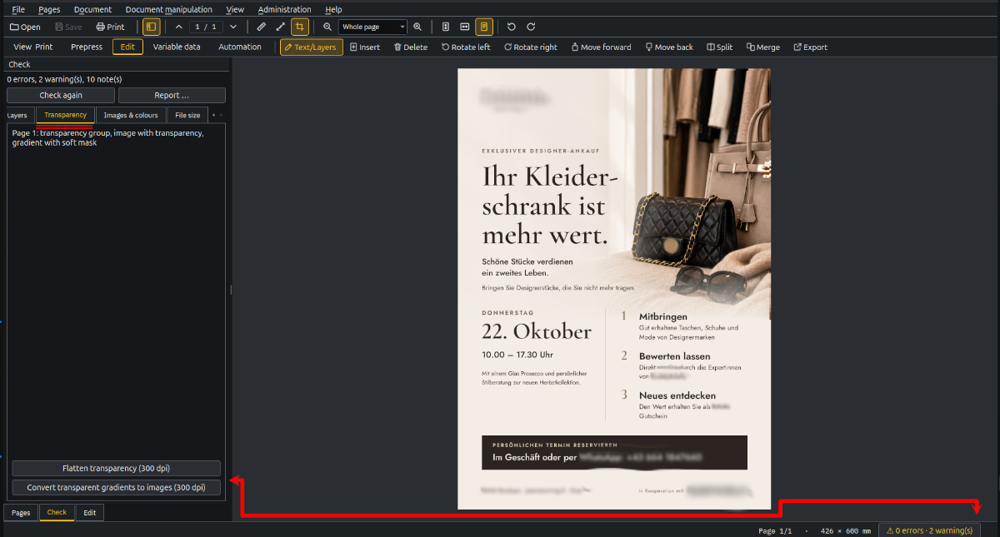
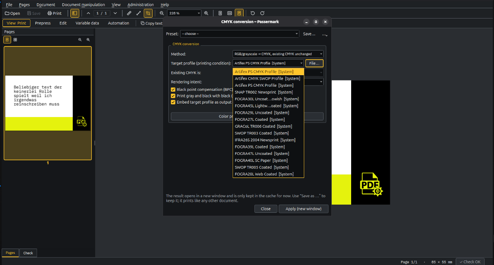
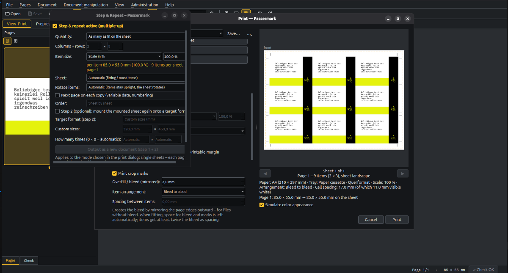
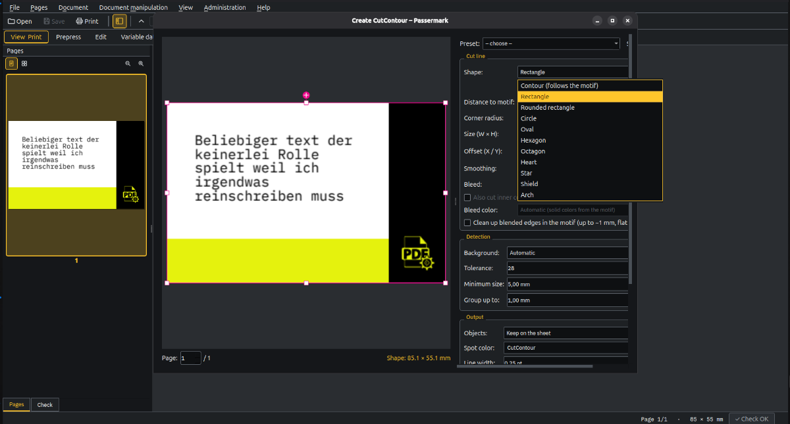
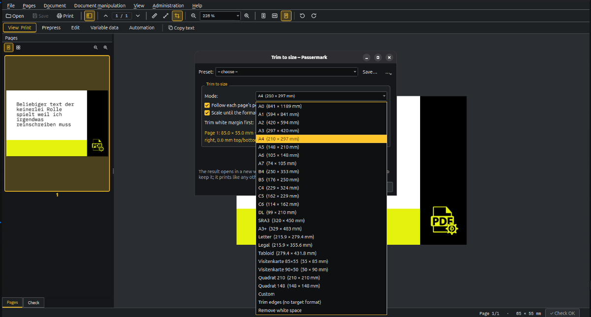
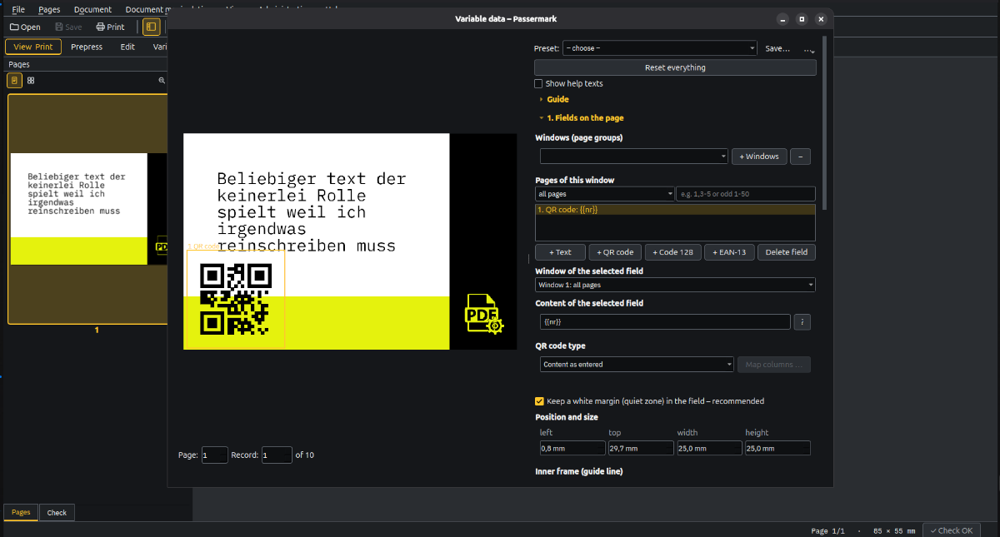

# Passermark 1.18.2

Visor de PDF, herramienta de impresión y caja de herramientas de preprensa para **Linux y Windows**.
Software libre (GPL-3.0-or-later).

**English:** [README.md](README.md) · [Deutsch](README.de.md) · [Magyar](README.hu.md) · [Français](README.fr.md) · **Español**

> **Estado:** un proyecto privado, desarrollado junto al trabajo diario de preprensa. Los comentarios son
> bienvenidos – las respuestas y las nuevas funciones se ofrecen sin garantía. Probado con controladores de
> CUPS y de Windows (inyección de tinta, impresoras de oficina y de producción con encuadernadora a través de
> un servidor de impresión); los controladores menos comunes y las opciones de acabado pueden necesitar
> ajustes.

## Capturas de pantalla

| | |
|---|---|
|  |  |
|  |  |
|  |  |

## Funciones

- **Ver e imprimir** PDF, imágenes (también HEIC, SVG) y archivos de Office (a través de LibreOffice).
  Utiliza los controladores de impresora ya instalados (CUPS en Linux, controladores de Windows) con todas
  sus opciones.
- **Imposición (Ausschießen):** ajustar/escalar, varias páginas por hoja, póster, step & repeat; folletos
  como grapado a cabalga secciones agrupadas u hojas sueltas apiladas (encuadernación encolada), con
  desplazamiento (creep), páginas en blanco, marcas de plegado, de registro y de cotejo y vista general de
  hojas. También en la línea de comandos (`passermark-cli impose`). El step & repeat permite montar la hoja terminada una segunda vez en un formato destino de libre elección (paso 2) – ahora también al imprimir directamente desde el diálogo de impresión.
- **Plan & Poster:** impresión de planos y pósters en aparatos de rollo – rollos leídos del aparato (IPP, si no SNMP), «comprobar aparato» solo lectura con informe JSON; elección del rollo automática (el más estrecho que encaje, por gramaje/material) o fija, posición centrada o en el borde; metros lineales en vivo con aviso antes de que se acabe el rollo, «cortar individualmente» convierte cada ejemplar en un trabajo propio; herramientas de planos (escalado, rotación, bandas de relleno, marcas de corte, elevar las líneas finas, marcas de plegado según DIN 824), herramientas de pósters (dobladillo, marcas de ojetes, CutContour, marcas de registro para print & cut con la Roland), más ancho que el rollo se divide en bandas; materiales por usuario. También en la línea de comandos (`passermark-cli plan`/`poster`, `--dry-run` solo calcula los metros lineales), como paso de flujo y como salida a carpeta vigilada, p. ej. para VersaWorks.
- **Manipulación de documentos:** conversión CMYK con vista previa de color, recorte al formato, separar
  objetos, **CutContour** para plotter de corte (contorno, formas, sangrado, cortes interiores; redimensionar
  y mover formas con tiradores). El recorte ahora también con «recortar bordes» (mm por lado, sin formato
  destino) y «eliminar el espacio blanco» (detectar el contenido, nuevo marco de página ± margen, el
  contenido queda 1:1).
- **Dividir páginas:** mitades o rejilla como páginas separadas – p. ej. un folleto exportado como páginas
  dobles; seleccionar páginas, botón derecho → Dividir. Sin pérdida (no se rasteriza nada), se respetan el
  formato final y el sangrado.
- **Preflight:** comprueba al abrir un documento fuentes, capas, transparencias, cajas de página (crop/trim/bleed), sangrado del contenido, protección, PDF/X y output intent, campos de formulario y páginas vacías; correcciones: incrustar o
  sustituir fuentes (fuentes libres métricamente compatibles o descarga desde fontsource.org), texto a
  curvas, fijar/eliminar capas, aplanar transparencias. Cada hallazgo nombra su sitio (p. ej. «página 2 – abajo a la derecha, 40 × 20 mm»); un clic salta hasta él y lo enmarca en rojo, con ◀ ▶ recorres los hallazgos.
- **Edición:** seleccionar líneas de texto y capas con el ratón; cambiar texto, fuente y tamaño; mover,
  escalar, ocultar, eliminar o sustituir capas; deshacer.
- Reglas y medición: reglas en mm al borde de la vista; clic en inicio y fin para medir (Mayús se alinea en
  horizontal/vertical/45°), resultado en la barra de estado. Con Control pulsado, la cruceta se imanta a las líneas de corte e interiores (borde de página,
  formato final, sangrado), a los bordes de imágenes y a las líneas vectoriales – nunca al texto; se pega
  al borde hasta que el ratón se aleja claramente. La visualización del formato final lo muestra en verde, con el sangrado en línea de puntos.
- **Datos variables:** numeración (inicio, paso, dígitos, dígitos de control, hacia atrás, contador que
  continúa), texto desde CSV, códigos QR, Code 128 y EAN-13 como vectores (con zona de silencio);
  marcadores `{{…}}` en el PDF; fecha, página, número aleatorio y otras variables; varias páginas por
  registro (anverso/reverso) y campos en páginas impares/pares; registro de códigos; step & repeat con su
  propio registro por copia (hoja por hoja o cortar y apilar). También en la línea de comandos
  **ventanas (grupos de páginas)** para plantillas de varias páginas – p. ej. anverso con el nombre, reverso con un código QR – con selección de páginas por ventana (todas/impares/pares o intervalos) y distribución de registros hoja por hoja o página por página (`passermark-cli vdp`).
- **Introducir datos:** crear la tabla de datos directamente en Passermark – tarjeta de visita QR (vCard),
  acceso WLAN, correo electrónico, dirección web, llamada, SMS, cita, ubicación, Code 128, EAN-13 – con las
  columnas adecuadas, comprobación inmediata y pegado desde Excel; guardado como CSV y utilizable
  directamente en los datos variables. Los archivos CSV propios con otros nombres de columna (p. ej.
  exportaciones de contactos de Outlook, Google, Thunderbird) se asignan automáticamente. Siete ejemplos
  listos (Ayuda → Obtener ejemplos).
- **Áreas de trabajo** (Ver e imprimir, Plan & Poster, Preprensa, Editar, Datos variables, Automatización) con su propia
  barra de herramientas.
- **Preajustes** para CutContour, CMYK/recorte, diseño de impresión y datos variables – compartidos con la
  línea de comandos.
- **Registro de impresión:** por usuario en los ajustes, o impuesto por el administrador – un JSON por trabajo con los ajustes exactos, además de un `printlog.csv`; `passermark-cli reprint <log.json>` reimprime un trabajo en cualquier momento (con aviso si el original ha cambiado).
- **Automatización:** flujos paso a paso con condiciones («if» en cada paso, bifurcaciones «choose»/«else», «fail»/«stop» con mensaje); `passermark-cli serve` vigila carpetas y envía cada archivo por el flujo asignado – `serve --init` crea una plantilla con un ejemplo.
- **Softproof:** simular el resultado de impresión en la vista (Ctrl+Y) – como condición de impresión, un material, un perfil de la administración o un perfil CMYK del sistema, con intención de renderizado (intent) y BPC; simular el color del papel y la tinta negra de impresión, avisos para los colores fuera del intervalo imprimible y para la cobertura de tinta por encima de un límite en %.
- **Materiales:** registrar papeles (gramaje, superficie, intención de renderizado, perfil por impresora); blanco de papel medido con ArgyllCMS (spotread), desde un archivo de medición CGATS o a mano; sugerencias de perfiles ordenadas por ΔE2000. Los materiales ajustan perfil e intención en el diálogo de impresión y en la conversión CMYK; la vista previa de color toma el blanco de papel medido.
- **Comprobación de color:** en el nuevo menú Color (Ctrl+Mayús+F) – una barra lateral como el preflight: elegir la condición de impresión, Passermark muestra lo que contiene el documento (RGB, cobertura de tinta, colores directos, output intent) y hallazgos en texto claro, cada uno con su botón para corregirlos; los hallazgos son clicables.
- **Exportar para la imprenta:** un asistente en cuatro pasos – elegir la condición de impresión, convertir según la recomendación, comprobar, guardar; el ICC siempre incrustado como output intent, con RGB pregunta siempre; paquete opcional con PDF, perfiles e informe. También en la línea de comandos (`passermark-cli press`).
- **Papeles y mediciones:** materiales propios sin derechos de administrador (`~/.config/passermark/materials.json`, guardados al instante); el botón «Medir papel …» crea el papel e inicia la medición, «Buscar dispositivo» encuentra el aparato X-Rite a través de ArgyllCMS; la lista de materiales vacía en el diálogo de administración ahora explica los primeros pasos.
- **Perfiles estándar:** cargar PSO Coated/Uncoated v3, FOGRA39/47, SC-B, GRACoL y SWOP desde registry.color.org en tu propia carpeta de ICC con «Obtener perfiles estándar» (no se incluyen por motivos de licencia); las sugerencias también muestran los perfiles aún no instalados.
- Reparar/optimizar PDF, PDF/A, protección con contraseña (también al «Guardar como PDF» en el diálogo de
  impresión), fusionar archivos, seleccionar y copiar texto.
- Idiomas: español, alemán, inglés, húngaro, francés.

## Instalación

**Windows:** descargar `Passermark-<versión>-Setup.exe` desde [Releases](../../releases) y ejecutarlo. Todo
está incluido (Python, Qt, Ghostscript).

**Linux (cualquier distribución):** descargar `Passermark-<versión>-x86_64.AppImage` desde
[Releases](../../releases), luego
```sh
chmod +x Passermark-*-x86_64.AppImage
./Passermark-*-x86_64.AppImage
```

**Linux (Debian/Ubuntu, instalación en el sistema con integración en el gestor de archivos):**
```sh
sudo ./install.sh        # instala dependencias vía apt, entrada de menú, menú de Nautilus
sudo ./uninstall.sh      # eliminar de nuevo (--dry-run muestra una vista previa, --purge también elimina /etc/passermark)
```

Opcional: LibreOffice (archivos de Office), 7-Zip (importar perfiles ICC desde archivos), ArgyllCMS (medir el blanco de papel de los materiales – paquete de Linux `argyll`).

## Línea de comandos

Todas las funciones pesadas funcionan también sin interfaz – para scripts, carpetas enteras y automatización:

```sh
passermark-cli list                                   # tareas disponibles
passermark-cli settings cutcontour > pegatina.json     # valores predeterminados = plantilla de preajuste
passermark-cli cutcontour entrada.pdf salida.pdf --set shape=rect --set bleed_mm=2
passermark-cli cutcontour entrada.pdf salida.pdf --preset pegatina.json --pages 1,3-5
passermark-cli cutcontour entrada.pdf salida.pdf --preset "Sticker rund"   # preajuste guardado en el programa
passermark-cli presets                                # preajustes guardados en el programa
```

Tareas: `cutcontour`, `separate`, `manip` (CMYK/recorte), `repair`, `preflight_fix`, `impose`, `vdp`,
`split`, `press` (exportación para la imprenta), `plan`/`poster` (impresión de planos y pósters en rollo); además `beispiele`, `datenarten`, `datenvorlage`, `datencheck` (tablas de datos). Ajustes
anidados con punto (`--set detect.tolerance=40`). Ctrl+C interrumpe limpiamente (ningún archivo a medias).
Códigos de retorno: 0 terminado, 1 error, 2 indicación incorrecta, 130 cancelado. `--json-progress` imprime
el progreso y el resultado como líneas JSON. Las tareas grandes usan varios núcleos; limitar con la variable
de entorno `PASSERMARK_WORKERS` (1 = sin paralelismo).

`passermark-cli serve` vigila carpetas de entrada (`--init` crea una plantilla con un ejemplo); `passermark-cli reprint <log.json>` reimprime un trabajo desde el registro de impresión.

Dónde: Linux `install.sh` → `passermark-cli`; AppImage → `Passermark-*.AppImage --cli …`;
Windows → `passermark-cli.exe` en la carpeta de instalación (opción de instalación: añadirlo al PATH).
Guías con ejemplos en el programa: **Ayuda → Línea de comandos – guía** y
**Ayuda → Datos variables – guía**.
Interfaz para programas externos (eventos JSON estables, códigos de error): [docs/cli-api.md](docs/cli-api.md).

## Registros de errores

Si algo falla, Passermark escribe un archivo de registro para adjuntar (Ayuda → Abrir registros de errores):
Linux `~/.local/state/passermark/logs`, Windows `%LOCALAPPDATA%\Passermark\logs`. Tras un fallo, el siguiente
inicio señala el registro. Los registros sin errores se eliminan al salir.

## Compilación

Localmente: `powershell -ExecutionPolicy Bypass -File windows\build.ps1` (Windows, necesita Python 3.12 e
Inno Setup 6) o `./linux/build-appimage.sh` (Linux, los paquetes necesarios en la cabecera del script).

Pruebas: `python3 tests/test_<nombre>.py` (no se necesita framework de pruebas).

## Licencia

GPL-3.0-or-later, véase `LICENSE`. El instalador de Windows y el AppImage contienen
[Ghostscript](https://ghostscript.com) (AGPL-3.0, Artifex Software).

Licencias de terceros: el instalador y el AppImage incluyen junto al programa una carpeta
`licenses` (Ayuda → Licencias …) con `THIRD_PARTY_NOTICES.txt`, los archivos de licencia de todos
los paquetes de Python incluidos, el aviso LGPL de Qt/PySide6 (cómo sustituir las bibliotecas de Qt)
y el aviso de Ghostscript con los enlaces al código fuente de la versión incluida. Previa solicitud
también se facilita el código fuente correspondiente de los componentes incluidos: abra un issue en
[GitHub](https://github.com/groschenheld/passermark/issues).

