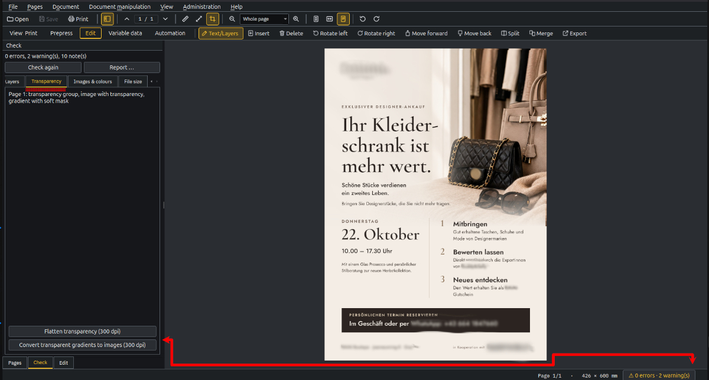
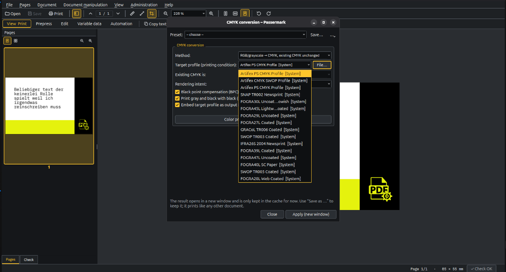
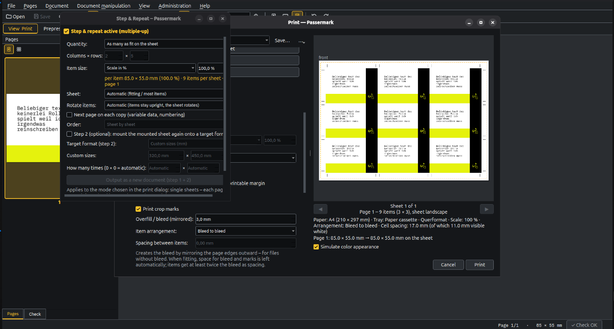
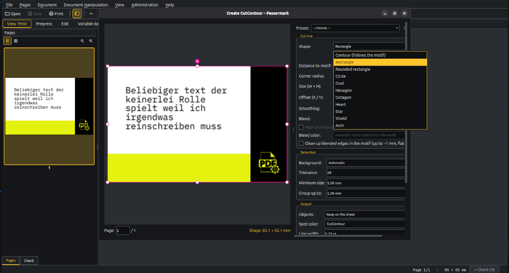
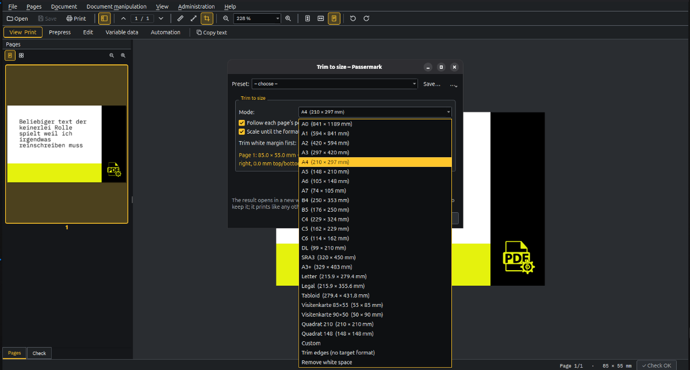
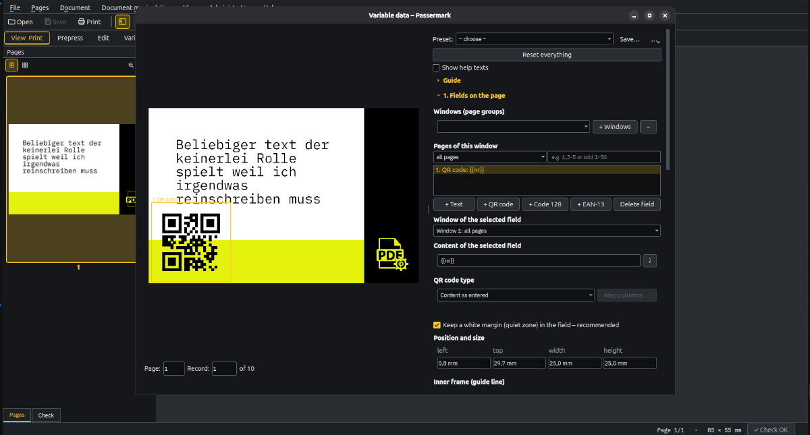

# Passermark 1.18.18
PDF viewer, print tool and prepress toolbox for **Linux and Windows**. Free software (GPL-3.0-or-later).

**English** · [Deutsch](README.de.md) · [Magyar](README.hu.md) · [Français](README.fr.md) · [Español](README.es.md)

> **Status:** a private project, developed alongside daily prepress work. Feedback is
> welcome – answers and new features come without any guarantee. Tested with CUPS and Windows drivers
> (inkjet, office/production printers with finishers via a print server); less common drivers and finisher
> options may need adjustments.
>
> **Test rig:** for testing, a virtual machine park runs – nine simulated printers (Canon, Xerox, Epson, Roland, GBC),
> including finisher functions and with PDF and log output per print:
> [Virtual-Printer-Machine-Fleet](https://github.com/groschenheld/Virtual-Printer-Machine-Fleet).
> It was built by Claude and has served my testing purposes so far – suggestions for improvement are welcome.

## Screenshots

| | |
|---|---|
|  |  |
|  |  |
|  |  |

## Features

- **View and print** PDFs, images (incl. HEIC, SVG) and Office files (via LibreOffice). Uses the printer
  drivers already installed on your system (CUPS on Linux, Windows drivers) with all their options. Borderless printing where the driver supports it – paper variants, driver options and IPP queues alike, with PDFs with bleed running over the edge.
- **Imposition:** fit/scale, N-up, poster tiling, step & repeat; booklets as saddle stitch, grouped signatures
  or stacked single sheets (perfect binding), with creep, blank-page filling, fold/registration/collation marks
  and a sheet overview. Also on the command line (`passermark-cli impose`). Step & repeat can mount the finished sheet a second time onto a freely chosen target format (step 2) – now also when printing directly from the print dialog.
- **Plan & Poster:** plan printing and poster printing on roll devices – rolls read from the device (IPP, otherwise SNMP), “check device” read-only with a JSON report; roll choice automatic (narrowest fitting one, by grammage/material) or fixed, position centred or at the edge; running metres live with a warning before the roll runs short; plan tools (scaling, rotation, overspill strips, cut marks, hairline lifting, fold marks to DIN 824), poster tools (hem, eyelet marks, CutContour, registration marks for print & cut with the Roland), anything wider than the roll is split into panels; materials per user – the media of the loaded rolls are in the list automatically (marked “(device)”) and pick exactly that roll; via IPP the media catalogue is read as well, so media set up but not loaded appear in the list as “(device, not loaded)” and are sent to the driver with their media type. Every material has a colour path – convert, embed as output intent only, or pass through unchanged – plus source, date and a checked flag; materials can be adopted from the device or imported from CSV or JSON, on the command line via `materials list` and `materials import`. Settings per plan: with individual plans or posters selected, material, roll, position, rotation, print area, margin, scaling (in percent or “short/long edge to … mm”) and overspill apply only to the selection – deviations show up in the list with ✎. Shipping defaults to “one job, one sheet per copy” with one job per copy or a copy count as options; under the list a preview renders every printed sheet small, with size, roll and cut count. Also on the command line (`passermark-cli plan`/`poster`, `--dry-run` only calculates running metres, `--copies-mode sheets|jobs|count`, per-page `overrides`), as a workflow step and as hotfolder output e.g. for VersaWorks; the print log saves the overrides, so reprinting matches. After printing, the window opens with the default settings again (only the printer stays); "Save as default" sets your own default per plan and poster printing, "Default" resets all fields – and a poster job demands exactly the medium of the loaded roll when the device reports it; if that name matches no media type in the driver, "Auto" or the driver default goes out instead. A history keeps the last 50 prints with their PDFs, settings and quantities: reopen via the "History" button or "Plan & Poster -> Last prints", clean up with "Clean up history ..."; the dry run shows per job the driver values and the roll medium. Plan and poster each open their own window with its own taskbar entry (passermark --plan/--poster with files starts it directly); after printing it stays open and returns to the default, and a Quality toggle picks production or quality printing from the driver levels (quality_mode on the command line).
- **Document manipulation:** CMYK conversion with colour preview, crop to format, separate objects,
  **CutContour** for cutting plotters (contour, shapes, bleed, inner cuts; resize and move shapes with handles).
  Cropping now also with "trim edges" (mm per side, without a target format) and "remove white space"
  (detect the content, new page frame ± margin, content stays 1:1).
- **Split pages:** halves or a grid as single pages – e.g. a booklet exported as spreads; select pages,
  right-click → Split. Lossless (content is not rasterised), trim box and bleed respected.
- **Preflight:** checks fonts, layers, transparency, page boxes (crop/trim/bleed), bleed at the content, protection, PDF/X and output intent, form fields and empty pages when a document is opened; fixes: embed or substitute
  fonts (free metric-compatible fonts or download from fontsource.org), outline text, fix/remove layers,
  flatten transparency. Every finding names its position (e.g. "page 2 – bottom right, 40 × 20 mm"); one click jumps there and frames it in red, ◀ ▶ walks through the findings. New is the format-against-device check: pages are compared with the paper formats of the default printer – a note if the driver supports custom sizes; roll devices report when a page is wider than every roll.
- **Edit mode:** select text lines and layers with the mouse; change text, font and size; move, scale,
  hide, remove or replace layers; undo. A Move section: snapping to page edge, final format, bleed, page centre, other objects and an adjustable grid with a dashed guide line, automatic rulers, offset and position in mm in the status bar while dragging, and step-by-step moving in mm, pt or px with the arrow keys – Shift ten times as far, also for rotated views.
- Rulers and measuring: rulers in mm at the edge of the view; click start and end to measure (Shift snaps to
  horizontal/vertical/45°), result in the status bar. Holding Ctrl, the crosshair snaps magnetically to trim and inner lines (page edge,
  trim size, bleed), image edges and vector lines – never to text; it sticks to the edge until the
  mouse pulls clearly away. The trim-size overlay shows the trim in green and the bleed as a dotted line.
- **Variable data:** numbering (start, step, padding, check digits, reverse, continue counter), text from CSV,
  QR codes, Code 128 and EAN-13 as vectors (with quiet zone); placeholders `{{…}}` in the PDF; date, page,
  random and other variables; several pages per record (front/back) and fields on odd/even pages; code log;
  step & repeat with a different record per copy (row by row or cut & stack); **windows (page groups)** for multi-page templates – e.g. front sides with the name, back sides with a QR code – with page selection per window (all/odd/even pages or ranges) and record distribution sheet by sheet or page by page. Also on the command line
  (`passermark-cli vdp`). With Check data before generating: text too long or too tall for its field, measured with the field's font, empty columns, unknown placeholders, invalid EAN-13, codes without content – every finding with its row in the CSV. Image fields as well: path from the CSV, formats PNG, JPG, TIFF, BMP, GIF, WebP and PDF (first page, stays vector), fit, fill or distort, fallback image for empty columns or missing files, repeated images stored once in the PDF.
- **Enter data:** build the data table inside Passermark – QR business card (vCard), Wi-Fi access, e-mail, web
  address, phone, SMS, event, location, Code 128, EAN-13 – with matching columns, instant checks and paste from
  Excel; saved as CSV and used directly in variable data. Own CSV files with other column names (e.g. contact
  exports from Outlook, Google, Thunderbird) are mapped automatically. Seven ready-made examples
  (Help → Get examples).
- **Workspaces** (View & Print, Plan & Poster, Prepress, Edit, Automation) with their own tool row.
- **Presets** for CutContour, CMYK/crop and print layout – shared with the command line.
- **Print log:** per user in the settings, or forced by the admin – one JSON per job with the exact settings and the pages sent per copy (`out_pages`), plus a `printlog.csv`; `passermark-cli reprint <log.json>` reprints a job at any time (with a warning if the original has changed). For a print from a workflow the log also records order variables – order, item, qty, product and shop, as plain text with at most 120 characters.
- **Automation:** step-by-step workflows with conditions ("if" on every step, "choose"/"else" branches, "fail"/"stop" with a message); `passermark-cli serve` watches folders and sends every file through the assigned workflow – `serve --init` sets up a template with an example.
- **Shared print folder:** one hotfolder for everyone – set up through a button in the administration (“Set up shared print folder …”), through install.sh or through `passermark-cli shared-folder`; a single root helper creates the group and the folder (root:passermark, 2775, default ACL, the users join the group, symbolic links are rejected); under Windows the three subfolders `hotfolder`, `ausgabe` and `archiv` get Modify permission for the users – the rest of ProgramData stays reserved for the administrators.
- **Soft proofing:** simulate the print result in the view (Ctrl+Y) – the print condition is a material, a profile from the administration or a system CMYK profile, with intent and BPC; simulate paper colour and black printing ink, warnings for colours outside the printable gamut and for the ink coverage above a limit in %.
- **Materials:** register papers (grammage, surface, rendering intent, profile per printer); paper white measured with ArgyllCMS (spotread), from a CGATS measurement file or by hand; profile suggestions ranked by ΔE2000. Materials set profile and intent in the print dialog and in the CMYK conversion, and the colour preview takes the measured paper white.
- **Colour check:** in the new Colour menu (Ctrl+Shift+F) – a side panel like the preflight: pick the print condition, Passermark shows what is in the document (RGB, ink coverage, spot colours, output intent) and plain-text findings, each with a button to fix it; findings are clickable. The colour eyedropper (Ctrl+Shift+C, also in the Colour menu) picks a colour off the page: object type, the colour as it stands in the PDF, and C, M, Y and K in percent computed with the chosen print condition – over the limit turns red; take it over directly as CMYK or RGB for editing, or copy all values as text.
- **Export for the press:** a wizard in four steps – pick the print condition, convert as recommended, check, save; the ICC profile always embedded as output intent, RGB always asks; optional package with PDF, profiles and a report. Also on the command line (`passermark-cli press`).
- **Papers and measurements:** own materials without admin rights (`~/.config/passermark/materials.json`, saved immediately); “Measure paper …” creates the paper and starts the measurement, “Find device” finds the X-Rite device via ArgyllCMS; the empty material list in the admin dialog now explains the first steps.
- **Standard profiles:** load PSO Coated/Uncoated v3, FOGRA39/47, SC-B, GRACoL and SWOP from registry.color.org into your own ICC folder with “Get standard profiles” (not bundled for licence reasons); suggestions also show profiles that are not installed yet.
- Repair/optimise PDFs, PDF/A, password protection (also when saving as PDF from the print dialog), merge files,
  select and copy text.
- Languages: English, German, Hungarian, Spanish, French.

## Install

**Windows:** download `Passermark-<version>-Setup.exe` from
[Releases](../../releases) and run it. Everything is included (Python, Qt, Ghostscript).

**Linux (any distro):** download `Passermark-<version>-x86_64.AppImage` from [Releases](../../releases), then
```sh
chmod +x Passermark-*-x86_64.AppImage
./Passermark-*-x86_64.AppImage
```

**Linux (Debian/Ubuntu, system install with file-manager integration):**
```sh
sudo ./install.sh        # installs dependencies via apt, desktop entry, Nautilus menu
sudo ./uninstall.sh      # remove again (--dry-run to preview, --purge also removes /etc/passermark)
```

Optional: LibreOffice (Office files), 7-Zip (ICC profile import from archives), ArgyllCMS (measuring the paper white of materials – Linux package `argyll`).

## Command line

All heavy functions also run without the user interface – for scripts, batch processing and automation:

```sh
passermark-cli list                                   # available jobs
passermark-cli settings cutcontour > sticker.json     # default settings = preset template
passermark-cli cutcontour in.pdf out.pdf --set shape=rect --set bleed_mm=2
passermark-cli cutcontour in.pdf out.pdf --preset sticker.json --pages 1,3-5
passermark-cli cutcontour in.pdf out.pdf --preset "Sticker rund"   # preset saved in the program
passermark-cli presets                                # list presets saved in the program
```

Jobs: `cutcontour`, `separate`, `manip` (CMYK/crop), `repair`, `preflight_fix`, `impose`, `vdp`, `split`, `press` (export for the press), `plan`/`poster` (plan and poster printing on rolls);
plus `beispiele` (examples), `datenarten`, `datenvorlage`, `datencheck` (data tables). Nested settings with a dot
(`--set detect.tolerance=40`). Ctrl+C cancels cleanly (no half-written file). Exit codes: 0 ok, 1 error,
2 wrong usage, 130 cancelled. `--json-progress` prints progress and result as JSON lines. Large jobs use several CPU cores;
limit with the environment variable `PASSERMARK_WORKERS` (1 = no parallel processing).

`passermark-cli serve` watches drop folders (`--init` creates a template with an example); `passermark-cli shared-folder` sets up the shared print folder (`--user NAME`, `--status`); `passermark-cli reprint <log.json>` reprints a job from the print log.

Where: Linux `install.sh` → `passermark-cli`; AppImage → `Passermark-*.AppImage --cli …`;
Windows → `passermark-cli.exe` in the installation folder (setup option: add it to PATH).
Guides with examples (German PDFs) are in the program under **Help → Command line – guide** and
**Help → Variable data – guide**.
Interface for other programs (stable JSON events, error codes): [docs/cli-api.md](docs/cli-api.md).

## Error logs

If something goes wrong, Passermark writes a log file to send along (Help → Open error logs):
Linux `~/.local/state/passermark/logs`, Windows `%LOCALAPPDATA%\Passermark\logs`. After a crash, the next start
points to the log. Logs without errors are deleted on exit.

## Build

Local builds: `powershell -ExecutionPolicy Bypass -File windows\build.ps1` (Windows, needs Python 3.12 and
Inno Setup 6) or `./linux/build-appimage.sh` (Linux, see the script header for packages).

Tests: `python3 tests/test_<name>.py` (no test framework needed).

## Licence

GPL-3.0-or-later, see `LICENSE`. The Windows installer and the AppImage include
[Ghostscript](https://ghostscript.com) (AGPL-3.0, Artifex Software).

Third-party licences: the installer and the AppImage contain a `licenses` folder next to the
program (Help → Licences …) with `THIRD_PARTY_NOTICES.txt`, the licence files of every bundled
Python package, the Qt/PySide6 LGPL notice (how to replace the Qt libraries) and the Ghostscript
notice with the source links of the shipped version. On request the corresponding source code of
the bundled components is also provided – please open an issue on
[GitHub](https://github.com/groschenheld/passermark/issues).


